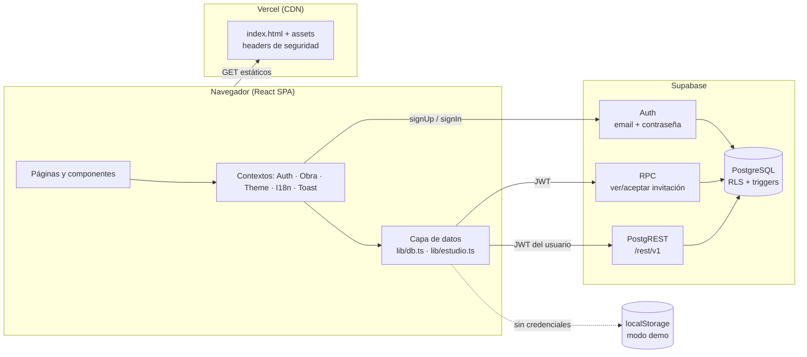

# 2. Arquitectura

## 2.1 Vista general

Aplicación **SPA** (Single Page Application) servida como estáticos desde la CDN de Vercel. No hay backend propio: el navegador habla directamente con **Supabase** (PostgREST + Auth), y toda la autorización se aplica en PostgreSQL con **Row Level Security**.



**Principio rector:** el frontend **nunca** es la barrera de seguridad. La UI oculta lo que un rol no debe usar (por UX), pero la base rechaza cualquier lectura/escritura no autorizada aunque se llame a la API a mano.

## 2.2 Stack

| Capa | Tecnología | Motivo |
|---|---|---|
| UI | React 19 + TypeScript 5.8 (strict) | Ecosistema, tipado estricto. |
| Build | Vite 6 | Arranque y HMR rápidos, code splitting por `import()`. |
| Estilos | Tailwind CSS 4 (tokens en `@theme`) | Diseño consistente; tema oscuro redefiniendo variables. |
| Animación | Framer Motion | Transiciones de ruta, modales, Kanban (`layout`). |
| Íconos | lucide-react | Livianos, tree-shakeables. |
| Ruteo | React Router 7 | Rutas anidadas, `lazy` + `Suspense`. |
| Backend | Supabase (Postgres 15+, Auth, PostgREST) | Auth + API + RLS gestionados, sin servidor propio. |
| Hosting | Vercel | CDN global, deploy automático desde `main`. |
| Tests | Playwright + axe-core | E2E, seguridad, rendimiento, accesibilidad. |

## 2.3 Capas del frontend

```mermaid
flowchart TB
  main[main.tsx<br/>providers] --> App[App.tsx<br/>rutas + lazy]
  App --> Pages[pages/ y pages/app/]
  Pages --> Comp[components/<br/>ui · CrudModule · Select · Layout]
  Pages --> Hooks[hooks/useTable]
  Hooks --> DB[lib/db.ts]
  Pages --> Est[lib/estudio.ts]
  Est --> DB
  DB --> SB[lib/supabase.ts]
  DB --> Seed[lib/demoSeed.ts]
  Comp --> I18n[i18n/ t()]
  Pages --> Roles[lib/roles.ts · lib/planes.ts]
```

| Capa | Archivos | Responsabilidad |
|---|---|---|
| Arranque | `main.tsx` | Árbol de providers: `MotionConfig › ThemeProvider › BrowserRouter › ToastProvider › AuthProvider › ObraProvider › I18nProvider › App`. |
| Ruteo | `App.tsx` | Rutas públicas, `/app/*` protegido por `RequireAuth`, carga diferida de páginas. |
| Layout | `components/Layout.tsx` | Sidebar por rol/plan, encabezado, guardas de navegación, transición entre rutas. |
| Páginas | `pages/`, `pages/app/` | Pantallas. Los módulos tabulares se definen por configuración (`modules.tsx`). |
| Componentes | `components/` | Design system (`ui.tsx`), `CrudModule`, `Select`, `Pricing`, `UserMenu`, etc. |
| Estado global | `context/` | Sesión y rol, obra activa, tema. |
| Datos | `lib/db.ts`, `lib/estudio.ts`, `hooks/useTable.ts` | Acceso a Supabase o a `localStorage` (demo) con la misma interfaz. |
| Dominio | `lib/roles.ts`, `lib/planes.ts`, `types/` | Tipos, roles, planes, cálculos de prueba gratuita. |
| i18n | `i18n/` | `t()` global y diccionarios EN/PT. |

## 2.4 Ruteo y guardas

```mermaid
flowchart TD
  R[Petición a /app/*] --> A{¿Sesión?}
  A -- no --> L[/login/]
  A -- sí --> B{Rol}
  B -- compras / direccion_obra --> C{¿Ruta /app/estudio*?}
  C -- no --> E[/app/estudio/]
  C -- sí --> OK1[Panel por rol]
  B -- jefe_obra --> D{Plan Inicial y ruta<br/>estudio·equipo·recursos?}
  D -- sí --> P[/app/planes/]
  D -- no --> F{¿Tiene obras?}
  F -- no --> PO[Creá tu primera obra]
  F -- sí --> OK2[Página pedida]
```



| Ruta | Página | Acceso |
|---|---|---|
| `/` | Landing | Público |
| `/login`, `/registro` | Login (modo según ruta; acepta `?next=` interno y `?plan=`) | Público |
| `/reset-password` | Nueva contraseña | Enlace de email |
| `/invitacion/:token` | Aceptar invitación | Público → requiere sesión para aceptar |
| `/app/obra/resumen` … | Módulos del jefe | `jefe_obra` |
| `/app/:seccion/:modulo` | `CrudPage` → módulo configurable | `jefe_obra` |
| `/app/estudio`, `/app/estudio/obras/:id` | Panel de gestión / resumen de tareas | Roles invitados (y jefes con plan ≠ Inicial) |
| `/app/equipo` | Invitaciones | `jefe_obra` con plan Estudio |

## 2.5 Capa de datos y modo demo

`lib/db.ts` expone `list`, `listIn`, `insert`, `update`, `remove` con **dos implementaciones** seleccionadas por `hasSupabase`:

| | Con Supabase | Modo demo |
|---|---|---|
| Persistencia | Postgres vía PostgREST | `localStorage` (`obrabase:demo:<tabla>`) |
| Usuario | JWT de Supabase Auth | `demo-user` (metadatos en `mock_meta`) |
| `user_id` | `default auth.uid()` en la tabla | Se completa en el cliente |
| Autorización | RLS | No aplica (datos locales) |
| Datos iniciales | Trigger de alta (primera obra) | `lib/demoSeed.ts` |

`hasSupabase` es `false` cuando faltan las variables o son placeholders; también se fuerza con `vite --mode demo` (`.env.demo` vacía las variables). Esto permite desarrollo, demos comerciales y **tests E2E deterministas** sin backend.

`hooks/useTable(table, orderBy, ascending)` encapsula el CRUD filtrado por la **obra activa** con *optimistic updates* y rollback ante error.

## 2.6 Estado

| Estado | Dónde | Persistencia |
|---|---|---|
| Sesión, usuario, rol | `AuthContext` | Supabase Auth (`localStorage` del SDK) |
| Obra activa | `ObraContext` | `localStorage` (`obrabase:obra_activa`) |
| Tema | `ThemeContext` + script en `index.html` | `localStorage` (`obrabase:theme`) |
| Idioma | `i18n/index.tsx` | `localStorage` (`obrabase:lang`) |
| Sidebar colapsado | `Layout` | `localStorage` (`obrabase:sidebar`) |
| Datos de módulos | Estado local de cada página (`useTable`) | Supabase |

No se usa una librería de estado global: el volumen de estado compartido es bajo y está acotado a contextos.

## 2.7 Internacionalización

- El **texto en español es la clave** (`t('Nueva tarea')`); los diccionarios `en.ts` y `pt.ts` mapean a la traducción. Falta → se muestra el español.
- `t()` es una función global (usable en configs y helpers). Al cambiar de idioma, `I18nProvider` re-monta el árbol (`key={lang}`) para re-renderizar todo.
- Detección: `localStorage` → `navigator.language` (pt/en) → español.

## 2.8 Rendimiento

- **Code splitting**: el dashboard, cada página de `/app` y la invitación se cargan con `React.lazy`. La landing no descarga código del panel (verificado por test).
- **Optimistic UI** en cambios de estado (Kanban, pedidos, servicios).
- Cache inmutable de 1 año para `/assets/*` (archivos con hash) vía `vercel.json`.
- Medido (build local): LCP 0,56 s landing · 0,62 s dashboard · JS inicial 231 KB gzip. Ver [§7](07-testing-y-calidad.md).
