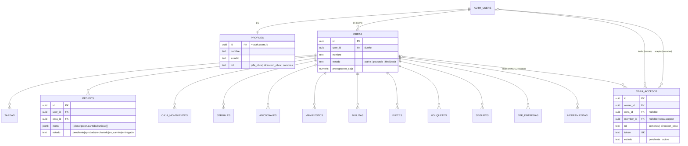

# 3. Modelo de datos

Fuente de verdad: [`supabase/schema.sql`](../supabase/schema.sql) (esquema completo, idempotente) y las migraciones incrementales en [`supabase/migrations/`](../supabase/migrations).

## 3.1 Diagrama entidad-relación



## 3.2 Convenciones

Todas las tablas operativas comparten:

| Columna | Tipo | Regla |
|---|---|---|
| `id` | `uuid` | PK, `gen_random_uuid()` |
| `user_id` | `uuid` | **Dueño de la fila**. `default auth.uid()`; no modificable (trigger `lock_user_id`). FK a `auth.users` con `on delete cascade`. |
| `obra_id` | `uuid` | FK a `obras` con `on delete cascade`. La obra debe pertenecer al mismo `user_id` (verificado en la política de INSERT/UPDATE). |
| `created_at`, `updated_at` | `timestamptz` | `updated_at` lo mantiene el trigger `set_updated_at`. |

Índice compuesto `(user_id, obra_id)` en cada tabla operativa. Los dominios cerrados se modelan con `text` + `CHECK` (más simple de migrar que `enum`).

## 3.3 Tablas

### Núcleo

| Tabla | Propósito | Columnas destacadas |
|---|---|---|
| `profiles` | Datos del usuario | `nombre`, `estudio`, `rol` (bloqueado tras el alta) |
| `obras` | Espacio de trabajo | `nombre`, `direccion`, `estado`, `presupuesto_caja` |
| `obra_accesos` | Invitaciones y accesos compartidos | `owner_id`, `obra_id` (NULL = todas), `member_id`, `rol`, `token` (18 bytes hex), `estado`, `accepted_at` |

### Operativas (todas con `user_id` + `obra_id`)

| Tabla | Columnas de negocio | Estados |
|---|---|---|
| `tareas` | `titulo`, `descripcion`, `prioridad`, `fecha_limite`, `etiquetas text[]`, `orden` | `por_comenzar`, `en_curso`, `en_pausa`, `terminada` |
| `pedidos` | `titulo`, `proveedor`, `prioridad`, `fecha_requerida`, `notas`, `items jsonb` | `pendiente`, `aprobado`, `rechazado`, `en_camino`, `entregado` |
| `caja_movimientos` | `fecha`, `tipo` (ingreso/egreso), `categoria`, `concepto`, `monto > 0` | — |
| `jornales` | `fecha`, `trabajador`, `categoria`, `asistencia`, `horas (0–24)`, `tarifa_hora` | — |
| `adicionales` | `fecha`, `descripcion`, `motivo`, `costo_estimado` | `propuesto`, `aprobado`, `rechazado` |
| `manifiestos` | `fecha`, `movimiento` (entrada/salida), `tipo` (plano/remito/documentación/otro), `referencia`, `responsable` | — |
| `minutas` | `fecha`, `titulo`, `asistentes text[]`, `temas`, `acuerdos jsonb` | — |
| `fletes` | `fecha`, `origen`, `destino`, `carga`, `transportista`, `costo` | `programado`, `en_transito`, `realizado`, `cancelado` |
| `volquetes` | `empresa`, `numero`, `fecha_entrega`, `fecha_retiro`, `costo` | `solicitado`, `en_obra`, `recambio`, `retirado` |
| `seguros` | `tipo` (ART/RC/técnico/otro), `aseguradora`, `poliza`, `vigencia_desde`, `vigencia_hasta`, `suma_asegurada` | Derivado: vigente / vence ≤ 30 d / vencida |
| `epp_entregas` | `fecha`, `operario`, `elemento`, `talle`, `cantidad`, `proximo_recambio` | — |
| `herramientas` | `nombre`, `categoria`, `cantidad`, `asignado_a` | `operativa`, `en_reparacion`, `baja` |

### Campos JSON

```jsonc
// pedidos.items
[{ "descripcion": "Cemento portland", "cantidad": 40, "unidad": "bolsa" }]

// minutas.acuerdos
[{ "texto": "Enviar plano de aberturas", "responsable": "Arq. Silva", "fecha": "2026-11-22" }]
```

Se eligió `jsonb` para ítems y acuerdos porque se leen y escriben siempre junto con su padre (atómico, sin joins); ver [ADR-004](08-decisiones.md#adr-004).

## 3.4 Reglas de negocio en la base

| Regla | Implementación |
|---|---|
| Alta de usuario crea perfil (y "Mi primera obra" si es jefe) | Trigger `on_auth_user_created` → `handle_new_user()` |
| El dueño de una fila no cambia | Trigger `trg_lock_user` → `lock_user_id()` |
| El rol no cambia tras el registro | Trigger `trg_lock_rol` → `lock_rol()` |
| Un miembro solo modifica `estado` | Trigger `trg_miembro_estado` → `miembro_solo_estado()` en `pedidos`, `fletes`, `volquetes` |
| Aceptar invitación copia el rol del perfil | RPC `aceptar_invitacion(token)` |
| `updated_at` automático | Trigger `trg_updated_at` → `set_updated_at()` |

## 3.5 Reglas calculadas en el cliente

| Valor | Fórmula |
|---|---|
| Saldo de caja chica | `presupuesto_caja + Σ ingresos − Σ egresos` |
| % gastado | `egresos / (presupuesto + ingresos)` |
| Avance de obra | `tareas terminadas / tareas totales` |
| Alerta de póliza | `vigencia_hasta − hoy ≤ 30 días` |
| Días de prueba | `7 − días desde auth.users.created_at` |

## 3.6 Migraciones

| Archivo | Contenido | Depende de |
|---|---|---|
| `schema.sql` | Esquema completo actual (incluye 002 y 003). Para instalaciones nuevas. | — |
| `migrations/002_panel_estudio.sql` | `obra_accesos`, políticas de lectura compartida, RPCs de invitación. | Esquema base |
| `migrations/003_roles.sql` | `profiles.rol`, `rol_en_obra()`, políticas por rol, estado `rechazado`, trigger genérico de estado. | 002 |

Todas son **idempotentes** (`if not exists`, `drop policy if exists`, `create or replace`). El bloque *RESET* al inicio de `schema.sql` está comentado y borra datos: solo para empezar de cero.
