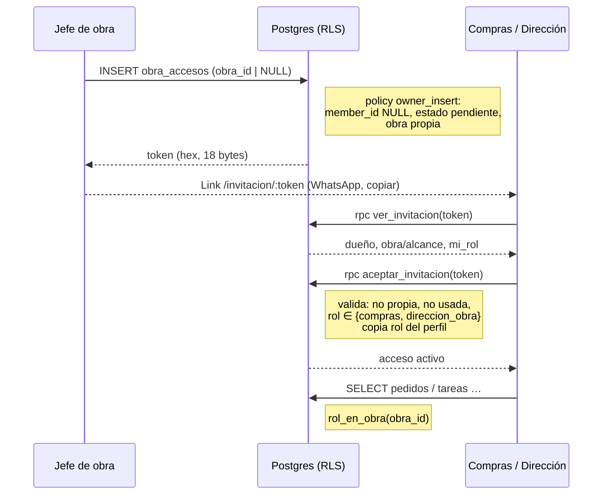
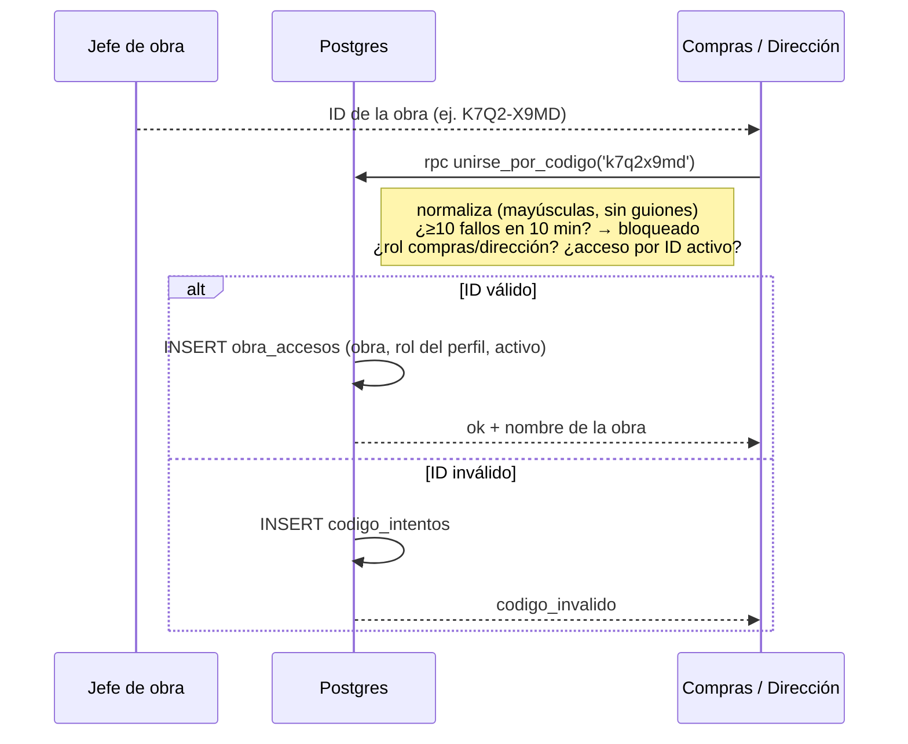

# 4. Seguridad y control de acceso

## 4.1 Modelo de amenazas (resumen)

| Activo | Amenaza | Mitigación |
|---|---|---|
| Datos de obra de un usuario | Otro usuario los lee/edita llamando a la API con la clave pública | **RLS** por `auth.uid()` en todas las tablas |
| Datos compartidos | Un invitado modifica más de lo permitido | Políticas por rol + trigger que solo permite cambiar `estado` |
| Permisos | Un usuario se sube de rol | `profiles.rol` bloqueado por trigger; el rol del acceso lo copia la RPC |
| Invitaciones | Adivinar o reutilizar tokens | Token aleatorio de 144 bits; un solo uso; revocable; sin `UPDATE` directo |
| ID de obra | Fuerza bruta / adivinar IDs | 31⁸ ≈ 8,5×10¹¹ combinaciones; 10 fallos / 10 min por usuario; generado por la base; regenerable y desactivable |
| Sesión | Robo vía XSS | React escapa todo; sin `dangerouslySetInnerHTML`; tests de XSS |
| Navegación | Open redirect en `?next=` | Solo rutas internas (una `/`, sin `\`) |
| Interfaz | Clickjacking, MIME sniffing | `X-Frame-Options: DENY`, `nosniff`, HSTS |
| Secretos | Filtración de claves | Solo clave pública en el cliente; `.env*` en `.gitignore`; test del bundle |

## 4.2 Autenticación

- Supabase Auth con **email + contraseña** (mín. 6 caracteres). Sesión JWT persistida por el SDK.
- Al registrarse se envían `nombre`, `estudio`, `plan` y **`rol`** como metadatos; el trigger los copia a `profiles`.
- Mensajes de error diferenciados en login/registro (credenciales inválidas, email sin confirmar con reenvío, email ya registrado), pero la **recuperación de contraseña responde siempre igual** para no revelar qué emails existen.
- Configuración necesaria en Supabase → *Authentication → URL Configuration*: Site URL de producción y Redirect URLs `/app/**` y `/reset-password`.

## 4.3 Autorización: Row Level Security

Todas las tablas tienen RLS habilitado. `anon` no tiene privilegios (`revoke all … from anon`). `authenticated` tiene `GRANT` de tabla, y RLS filtra las filas.

### Políticas del dueño (todas las tablas operativas)

| Operación | Condición |
|---|---|
| SELECT / DELETE | `auth.uid() = user_id` |
| INSERT / UPDATE | `auth.uid() = user_id` **y** la `obra_id` pertenece a `auth.uid()` |

### Políticas de miembros (accesos compartidos)

La función `rol_en_obra(obra_id)` (SECURITY DEFINER, `search_path` fijo) devuelve el rol del usuario actual sobre una obra compartida, o `NULL`.

| Tabla | `compras` | `direccion_obra` |
|---|---|---|
| `obras` | Lee | Lee |
| `tareas` | Lee | Lee |
| `pedidos` | Lee · **actualiza solo `estado`** | — |
| `fletes`, `volquetes` | Lee · **actualiza solo `estado`** | — |
| `caja_movimientos`, `seguros`, `adicionales` | Lee | — |
| Resto (`jornales`, `minutas`, `manifiestos`, `epp_entregas`, `herramientas`) | — | — |
| `profiles` del jefe | Lee (nombre/estudio) | Lee |

Ningún miembro puede INSERT ni DELETE en tablas operativas.

### Matriz de capacidades por rol

| Capacidad | Jefe de obra | Compras | Dirección de obra |
|---|:---:|:---:|:---:|
| Crear/editar obras y módulos propios | ✅ | ❌ | ❌ |
| Invitar / revocar (plan Estudio) | ✅ | ❌ | ❌ |
| Ver resumen de obra compartida | — | ✅ | Solo tareas |
| Aprobar / rechazar pedidos | Propios | ✅ (compartidos) | ❌ |
| Cambiar estado de fletes / volquetes | Propios | ✅ (compartidos) | ❌ |
| Aceptar invitaciones | ❌ | ✅ | ✅ |
| Sumarse con el ID de la obra | ❌ | ✅ | ✅ |
| Ver / regenerar / desactivar el ID | ✅ (propias) | ❌ | ❌ |

## 4.4 Flujo de invitación



- `obra_accesos` **no tiene `UPDATE`** para `authenticated`: solo la RPC (SECURITY DEFINER) puede activar un acceso.
- El dueño revoca con `DELETE`; el miembro puede salir borrando su propio acceso.
- El email cargado en la invitación es **informativo**: quien tenga el link puede aceptarlo una vez. Es un riesgo aceptado (compartir solo con quien corresponde; revocar si se filtra). Ver [§9](09-operacion-y-roadmap.md).

## 4.5 Sumarse con el ID de la obra



- El RPC **no lanza excepciones** ante un ID inválido (devuelve un estado) para que el intento fallido quede registrado: una excepción desharía el `INSERT` en `codigo_intentos`.
- El ID **no se puede elegir**: el trigger lo regenera en cada `INSERT` y bloquea cambios salvo desde `regenerar_codigo_obra` (marca de sesión `obrabase.regen_codigo`).
- Regenerar invalida el ID anterior; quienes ya se sumaron conservan el acceso hasta que el jefe lo revoque en Equipo.
- Riesgo aceptado: el ID es más corto que el token de invitación y quienes ven la obra también ven su ID. Mitigación: límite de intentos, regeneración y desactivación.

## 4.6 Integridad de escritura

```sql
-- Un miembro solo puede cambiar la columna "estado"
if auth.uid() is not null and old.user_id is distinct from auth.uid() then
  if (to_jsonb(new) - 'estado' - 'updated_at') is distinct from (to_jsonb(old) - 'estado' - 'updated_at') then
    raise exception 'Solo se puede cambiar el estado';
  end if;
end if;
```

## 4.7 Frontend y entrega

| Control | Detalle |
|---|---|
| XSS | Todo el contenido de usuario se renderiza como texto por React. Test con payloads `` y `<script>` en tareas, minutas y URL de invitación. |
| Open redirect | `?next=` aceptado solo si empieza con una `/`, no con `//` y sin `\`. Probado con 4 variantes. |
| Contraseñas | `type=password`, `autocomplete` correcto; nunca se guardan en storage (test). |
| Enlaces externos | `rel="noopener"` en `target=_blank`. |
| Headers (Vercel) | `X-Content-Type-Options: nosniff`, `X-Frame-Options: DENY`, `Referrer-Policy: strict-origin-when-cross-origin`, `Strict-Transport-Security` (2 años, preload), `Permissions-Policy` restrictiva. |
| Secretos | El cliente usa solo la **clave publishable/anon** (pública por diseño). Test que el bundle no contiene `service_role` ni claves secretas. |

## 4.8 Verificación automatizada

`e2e/security.spec.ts` analiza `schema.sql` de forma estática y falla si:
- alguna tabla no tiene RLS;
- alguna política se otorga a `anon`/`public`;
- alguna función SECURITY DEFINER no fija `search_path`;
- las RPC sensibles son ejecutables por `anon`;
- faltan los triggers de bloqueo de rol/dueño o el de "solo estado";
- el ID de obra no lo genera la base, se puede editar o no tiene límite de intentos.

> **Pendiente:** pruebas de RLS contra una base real (proyecto Supabase de staging con usuarios de prueba por rol). Ver [§9](09-operacion-y-roadmap.md).
