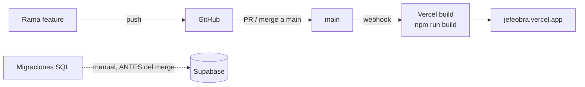

# 6. Entorno, desarrollo y despliegue

## 6.1 Requisitos

- Node.js 20+ (probado con 26) y npm.
- Cuenta de Supabase (proyecto con Auth email habilitado).
- Cuenta de Vercel conectada al repositorio de GitHub.

## 6.2 Variables de entorno

Archivo `.env.local` (ignorado por git). Se aceptan ambos prefijos (`envPrefix` en `vite.config.ts`):

| Variable | Ejemplo | Requerida |
|---|---|---|
| `VITE_SUPABASE_URL` o `NEXT_PUBLIC_SUPABASE_URL` | `https://<ref>.supabase.co` | Sí (si no, modo demo) |
| `VITE_SUPABASE_ANON_KEY` o `NEXT_PUBLIC_SUPABASE_PUBLISHABLE_KEY` | clave anon/publishable | Sí (si no, modo demo) |

> Solo se usa la clave **pública** (anon/publishable). La `service_role` **nunca** va al frontend.

`.env.demo` vacía las variables para forzar el modo demo (`--mode demo`).

## 6.3 Scripts

| Comando | Qué hace |
|---|---|
| `npm run dev` | Servidor de desarrollo (Supabase si hay credenciales). |
| `npx vite --mode demo` | Desarrollo en modo demo (datos de ejemplo en el navegador). |
| `npm run build` | `tsc --noEmit` + build de producción en `dist/`. |
| `npm run preview` | Sirve el build. |
| `npm run build:demo` | Build en modo demo en `dist-demo/` (lo usan los tests). |
| `npm run test:e2e` | Suite Playwright completa. |
| `npm run test:e2e:ui` / `test:e2e:report` | Interfaz de tests / reporte HTML. |

## 6.4 Puesta en marcha local

```bash
npm install
cp .env.example .env.local   # completar URL y clave
npm run dev
```

## 6.5 Base de datos

### Instalación nueva
Ejecutar **`supabase/schema.sql`** completo en *SQL Editor* (incluye todas las migraciones).

### Proyecto existente
Ejecutar en orden las migraciones que falten:

1. `migrations/002_panel_estudio.sql`
2. `migrations/003_roles.sql`
3. `migrations/004_codigo_obra.sql`

Todas son idempotentes: re-ejecutarlas no rompe nada ni borra datos.

### Configuración de Supabase

| Dónde | Valor |
|---|---|
| Authentication → URL Configuration → Site URL | `https://jefeobra.vercel.app` |
| Authentication → URL Configuration → Redirect URLs | `https://jefeobra.vercel.app/**`, `http://localhost:5173/**` |
| Authentication → Sign In / Providers → Email | Habilitado. *Confirm email* según política (ver nota). |
| Authentication → SMTP Settings | SMTP propio (p. ej. Resend con dominio verificado) para producción. |
| Authentication → Rate Limits | Subir "emails per hour" al configurar SMTP propio. |

> Con el SMTP por defecto de Supabase el límite es ~2 emails/hora por proyecto: el registro con confirmación falla con `over_email_send_rate_limit`. Mientras no haya dominio propio, se puede desactivar *Confirm email*.

## 6.6 Despliegue



1. Desarrollar en una rama (`feat/…`, `fix/…`, `test/…`).
2. Correr `npm run build` y `npm run test:e2e`.
3. Si hay cambios de base: **ejecutar la migración en Supabase antes de mergear** (el frontend nuevo puede depender de tablas/columnas nuevas).
4. Mergear a `main` → Vercel compila y publica automáticamente (1–2 min).
5. Verificar en producción.

`vercel.json` define el *rewrite* SPA, los headers de seguridad y el cache de `/assets/*`. Variables en Vercel: *Project Settings → Environment Variables* (requiere *Redeploy* al cambiarlas).

## 6.7 Rollback

- **Frontend:** en Vercel, *Deployments* → elegir el deploy anterior → *Promote to Production*.
- **Base:** las migraciones son aditivas. Para revertir, escribir una migración inversa (no hay *down* automático). Hacer backup antes de cambios destructivos (Supabase → *Database → Backups*).
